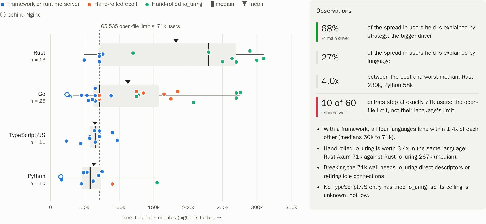

# What wins the $12 server challenge

Scope: Rust, Go, Python and TypeScript/JS (Node, Bun, Deno). Source: upstream's
[`LEADERBOARD.md`](../LEADERBOARD.md), scored on a 1 vCPU / 2 GB box, as of 2026-11-15. Same-code
re-runs vary by 5-15%, so ignore gaps under about 10k users.

## Take-aways

1. **Strategy explains 68% of the spread in scores, language 27%.** Pick the I/O model first, the
   language second.
2. **With a framework, language barely matters.** Framework medians: Rust 71k, TypeScript/JS 65k,
   Go 61k, Python 50k. That's within 1.4x. The fastest framework in the four is Node with
   uWebSockets, at 97k.
3. **Hand-rolled io_uring is worth 3-4x.** In the same language: Rust Axum 71k → io_uring 267k
   (median), Go net/http 55k → io_uring 276k (best), Python FastAPI 48k → PyPy io_uring 155k.
4. **Language sets the ceiling once the strategy is right.** Best hand-rolled io_uring per language:
   Rust 310k, Go 276k, Python (PyPy) 155k. No TypeScript/JS entry has tried it, so its ceiling is
   unknown, not low.
5. **A third of the entries hit the same wall, not their language's limit.** Many sit at exactly 71k,
   the 65,535 open-file limit, whatever their CPU use. Breaking it needs io_uring direct descriptors
   or retiring idle connections.

Interactive report: [`charts/score-by-language.html`](charts/score-by-language.html) (open it in a
browser). Pickers regroup the entries by language or strategy, recolour them, and switch the metric
(users held, req/s, CPU per request, CPU %, memory, p95). The statistics and tables follow. Rebuild with `python3 docs/charts/build_chart.py`.

**What the chart shows.** Each language's box is wide because its entries use different strategies,
not because the language is unpredictable. Colour sorts the dots left to right in every row: blue
(framework) at 15k-97k, orange (epoll) at 70k-185k, green (io_uring) at 120k-310k. Rust's median is
high only because most Rust entries are io_uring. TypeScript/JS has the tightest box because every
entry is a framework or runtime server.

## Biggest gains, ranked

| Change | Typical step | Example |
|---|---|---|
| Serve direct, drop Nginx | 2-3x | Go Fiber behind Nginx 24k; Python FastAPI behind Nginx 15k vs 48k direct |
| Hand-rolled event loop instead of a framework | 2-4x | Go net/http 55k → raw epoll 185k |
| io_uring with direct descriptors, past the 71k fd wall | 1.5-2x over epoll | Go epoll 185k → io_uring 276k |
| SQLite B-tree cursor reads instead of SQL | +8-15% | seen across languages at the top |
| SQLite tuning: one read transaction per pass, background checkpoints | +5-15% | rkkautsar (Rust) 260k → 300k |

## Least helpful, or harmful

- **More processes or threads on one vCPU.** A Go epoll entry with 3 processes held 125k; the best
  single-process Go epoll entry held 185k. The Rust entry with 5 worker processes holds 230k, below
  every single-loop Rust io_uring entry but one.
- **PGO and compiler flags.** The Go io_uring entry with PGO + ThinLTO held 125k, half the plain
  Go io_uring leaders. `target-cpu=native` moved a Rust entry 260k → 257k. Committed PGO profiles are
  now banned.
- **io_uring done naively.** One Go io_uring entry stalls on open connections at 29k and 21% CPU.
  The API alone doesn't help; the connection handling does.
- **A faster framework in a slow model.** Go fasthttp, gnet and Bun all stop at 61k-90k. Swapping
  frameworks doesn't move you past the fd wall.
- **Banned, so not worth trying:** read coalescing (one query answering several requests), a custom
  or patched SQLite, page-cache drops.

## Local runs (this fork)

We ran the best entry in each language on one core of an Apple Silicon Mac. Server CPU per request
at 20k req/s: **Rust 12 µs, Go 22 µs, Python (PyPy) 27 µs, Node 30 µs.** That is the same order as
upstream's scores. Node's cost triples upstream, where it holds 97k open connections, so its limit is
the cost of each connection, not the language's raw speed. Details and screenshots:
[`benchmark-stack.md`](benchmark-stack.md#results-so-far).
